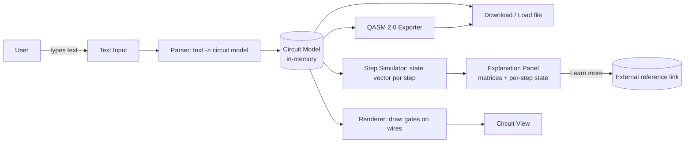

<!-- iteration: 4 -->
# Quantum Circuit Builder — High-Level Design (HLD)

**Status:** FINAL — LOCKED (Director-approved 2026-10-25)
**Author:** Jordan (Sr Engineer, HLD) · **Project:** `quantum-circuit-builder`
**Source:** `requirements.md` (FINAL)

## Assumptions (from locked requirements)
1. **No backend, no accounts.** This is a pure client-side single-page app (SPA). "Save" = download a file; "load" = read a file the user picks. Nothing is stored on a server.
2. Because there is no server, several standard HLD sections (database, cache, message queue, server auth, RPO/RTO, multi-region) have **no component to design**. They are addressed explicitly as N/A with the reason, rather than omitted.
3. Desktop web first; mobile is not a Phase 1–2 target.
4. Parser is rule-based (recognize named algorithms + qubit count), not an LLM. Requirements scope it to a fixed algorithm list plus Phase 3 gate-by-gate phrasing.

---

## System Overview



Plain English: The user types an algorithm in a box. A **parser** turns that text into an in-memory **circuit model** (ordered list of gates on qubits). Everything else reads that one model: a **renderer** draws the wires and gate boxes, a **step simulator** computes the quantum state after each gate for the explanation panel, a **QASM exporter** turns the model into OpenQASM 2.0 text, and a **download/load** layer serializes the model to a file and back. It all runs in the browser; there is no server.

### Component responsibilities
| Component | Input | Output | Notes |
|---|---|---|---|
| Text Input (F1) | keystrokes | raw string + Build event | Empty input → prompt, not error |
| Parser (F2) | raw string | Circuit Model or "not recognized" | Rule-based; maps named algorithms + qubit count |
| Circuit Model | — | canonical in-memory structure | Single source of truth for all other components |
| Renderer (F3) | Circuit Model | on-screen diagram (SVG) | One wire/qubit; gates in time order |
| Step Simulator (F6 math) | Circuit Model | state vector after each step | Hard cap 12 qubits (2^n memory); above it, draw/export still work |
| QASM Exporter (F4) | Circuit Model | OpenQASM 2.0 text | Must parse with zero errors |
| Explanation Panel (F6) | Circuit Model + sim | text + matrices + state, step-through | Deep math = external link |
| Download/Load (F5) | Circuit Model ↔ file | `.json` circuit file + `.qasm` | Browser File API; no server |

### Circuit Model (canonical structure)
```
CircuitModel {
  schemaVersion: int           // for forward-compat of saved files
  numQubits: int
  algorithmLabel: string       // e.g. "Grover (3 qubits), target |111>"
  params: { target?: string, ... }   // e.g. Grover oracle target
  gates: [ { name, qubits:[int], controls:[int], params:[float] } ]  // ordered = time order
}
```
This is the ONE structure the parser produces and every other component consumes. The LLD will finalize field names and the gate vocabulary.

---

## Wireframes

Low-fidelity layout only — exact styling, spacing, and colors are the Dev Team's call. These fix *where* each feature lives and *how the screens connect*, so Morgan's review and the LLD have a shared picture. Desktop-first (per NFR).

### Screen 1 — Main builder (default screen)
```
┌───────────────────────────────────────────────────────────────────────┐
│  Quantum Circuit Builder                        [Load file]  [Download ▾]│  ← F5 save/load
├───────────────────────────────────────────────────────────────────────┤
│  Describe your algorithm:                                               │
│  ┌───────────────────────────────────────────────────────┐  ┌────────┐ │  ← F1 input
│  │ Grover's algorithm for 3 qubits                        │  │ Build  │ │
│  └───────────────────────────────────────────────────────┘  └────────┘ │
│  (empty → "Try: Grover's algorithm for 3 qubits")   ⚠ parse msg here    │  ← F2 feedback
├───────────────────────────────────────────────────────────────────────┤
│  Circuit                                        target |111⟩  [change ▾]│  ← Grover oracle default + options
│                                                                         │
│   q0 ─H─────●──────H──X──●──X──H───                                     │  ← F3 diagram (SVG)
│   q1 ─H─────●──────H──X──●──X──H───     (current step column highlighted)│
│   q2 ─H─────⊕──────H──X──⊕──X──H───                                     │
│                                                                         │
│   ◀ Prev     ● ● ● ○ ○ ○ ○     Next ▶      [ Step through ]              │  ← F6 step control
├───────────────────────────────────────────────────────────────────────┤
│  Explanation                                    [▸ open panel]          │  ← F6 panel toggle
└───────────────────────────────────────────────────────────────────────┘
```

### Screen 2 — Explanation / step-through panel (expands beside or below the diagram)
```
┌── Explanation ─────────────────────────────────────────────────────────┐
│  Step 2 of 7 — Hadamard on q0, q1, q2                                    │
│  ─────────────────────────────────────────────────────────────────────  │
│  What this does (plain English):                                        │  ← F6 basic (Phase 1)
│  "Puts all 3 qubits into equal superposition — every state equally      │
│   likely — so Grover can search them at once."                          │
│                                                                         │
│  Gate matrix          │  State after this step        (F6 full, Phase 2)│  ← F6 math (matrices + per-step state)
│      1  [1  1]        │   1/√8 (|000⟩ + |001⟩ + ... + |111⟩)            │
│   H = ─ [1 -1]        │                                                 │
│     √2                │   [ rendered with KaTeX ]                       │
│                                                                         │
│  state view unavailable above 12 qubits                                 │  ← simulation cap note
│                                                                         │
│  Learn more about Grover's algorithm →  (external link)                 │  ← F6 deep math = link out
└─────────────────────────────────────────────────────────────────────────┘
```

### Flow — Download / Load (F5, no backend)
```
   [Download ▾]                         [Load file]
       │                                    │
       ├─ "Circuit (.json)"  → browser save │ → OS file picker
       └─ "OpenQASM (.qasm)" → browser save │ → read file → parse → Circuit Model → redraw
                                            │        │
                                            │        └─ invalid / newer schemaVersion → clear error, no corrupt load
```

### Wireframe → feature map
| Area in wireframe | Feature | Requirement |
|---|---|---|
| Text box + Build | F1 input | — |
| Parse message / supported list | F2 parser | unknown input names what IS supported |
| Circuit wires + gates | F3 diagram | one wire/qubit, time order |
| `target \|111⟩ [change ▾]` | Grover oracle | default target, options explained, never forced |
| Download ▾ / Load file | F5 save-by-download | no backend |
| Prev/Next + step dots | F6 step-through | state updates per step |
| Matrix + state columns | F6 math | matrices + per-step state inline |
| "Learn more →" | F6 deep math | external link, not inline |

---

## Technology Choices

| Choice | What | Why (1 line) | Rejected (1 line) |
|---|---|---|---|
| App type | Client-side SPA | Requirements forbid backend/accounts; everything is local | Server-rendered app — no server exists |
| Language | TypeScript | Types catch gate/qubit-index bugs the math depends on | Plain JS — too error-prone for state-vector math |
| UI framework | React (via Vite) | Component model fits input/diagram/explanation panels; huge ecosystem | Vanilla DOM — reinvents state handling for the step-through |
| Circuit engine | `quantastica/quantum-circuit` (MIT) | One JS lib gives QASM import/export, SVG drawing source, AND state-vector simulation | Hand-rolling QASM + simulation — months of work, high bug risk |
| Diagram rendering | **See "Drawing approach decision" below** | — | — |
| Math rendering | KaTeX | Renders matrices/kets fast, offline, no server | MathJax — heavier; server-side render — no server |
| Save format | JSON file (circuit model) + QASM file | Human-diffable, versionable, re-loadable without a server | Opaque binary — not inspectable, harder to support |
| Build/deploy | Vite build → static files | SPA is just static assets; cheapest possible hosting | Node server — nothing to serve dynamically |

### Server-side sections — N/A (stated per skill)
- **Database:** none. State lives in memory; persistence is user-downloaded files.
- **Cache:** none server-side. Browser may cache static assets via normal HTTP headers.
- **Message queue:** none. All work is synchronous in-browser.
- **Server auth:** none. No accounts, no login, no tokens.

---

## Drawing approach decision (delegated by Director)

Three options were evaluated for how the circuit diagram gets drawn.

| Option | Pros | Cons |
|---|---|---|
| **(a) Download + use a JS library** (e.g. `quantastica/quantum-circuit` for model+SVG, or `microsoft/quantum-viz.js` for pure-HTML rendering) | Fast to ship; battle-tested gate shapes; `quantum-circuit` ALSO gives us QASM import/export and state-vector simulation in the same package — covering F4 and F6 math too; runs offline; MIT licensed | Adopt the library's model or adapt to ours; styling constrained to what it exposes |
| **(b) Live API call to a rendering service** | No rendering code to maintain | Needs network every draw (fails offline); adds a server dependency the requirements explicitly rule out; latency per keystroke/build; a third party sees the user's circuits (privacy) |
| **(c) Draw in-house (SVG/Canvas)** | Full control of look and interaction; no dependency | Reimplements gate shapes, multi-control connectors, layout; slowest to ship; we'd STILL need a separate library for QASM + simulation, so it doesn't reduce dependencies |

**Recommendation: (a) — use `quantastica/quantum-circuit` as the engine, with a thin in-house SVG layer on top for the interactive step-through highlight.**

Rationale: option (b) is disqualified outright — it reintroduces a backend and breaks offline/privacy, contradicting a locked requirement. Between (a) and (c), (a) wins decisively because one MIT library covers three requirements at once — drawing source, OpenQASM 2.0 import/export (F4), and per-step state-vector simulation (F6 math). Choosing (c) would not even remove the dependency, since we'd still need a library for QASM and simulation. We keep a **thin in-house rendering wrapper** so the step-through can highlight the current gate/column and sync with the explanation panel — the one piece of interactivity the library doesn't give us for free.

LLD must confirm the library's SVG output is themeable enough, or render from its circuit model with our own SVG while still using it for QASM + simulation.

---

## API Contracts

There is **no network API** (no backend). The contracts that matter are the **internal module interfaces** and the **file formats**, since those are the real compatibility boundaries. The LLD owns exact signatures; the HLD fixes the surfaces.

### Internal module surfaces
| Module | Function (shape) | Returns |
|---|---|---|
| Parser | `parse(text: string): ParseResult` | `{ ok: true, circuit } \| { ok: false, message, supported: string[] }` |

**Parser specification (fixes review MAJOR-4).** The parser is the entry point for every success criterion, so its behavior is fixed here, not left to the LLD:
- **Matching strategy:** normalize input first (lowercase, trim, collapse whitespace, strip the possessive apostrophe so "grover's" = "grovers"), then match against a per-algorithm keyword set, not an exact string. "Grover's algorithm for 3 qubits", "grover 3 qubits", "grovers 3 qubit" all map to Grover-3.
- **Qubit-count extraction:** pull the first integer in the text as the qubit count; if none, use the algorithm's default (e.g. Grover default = 3).
- **Ambiguity policy — never guess:** if the text matches zero known algorithms, OR matches more than one, return `ok: false` with a message that NAMES the supported algorithms (satisfies F2's acceptance). A loose match that silently picks the wrong algorithm is a defect, not a feature.
- **Test matrix:** each supported algorithm has a fixture list of phrasing variants (correct spelling, missing apostrophe, abbreviated "3q", extra words) that must all resolve, plus near-miss strings that must be rejected with the supported-list message.
| Exporter | `toQasm2(circuit): string` | OpenQASM 2.0 text |
| Importer | `fromQasm2(text): ParseResult` | circuit model (Phase 3) |
| Serializer | `toFile(circuit): Blob` / `fromFile(file): ParseResult` | `.json` circuit file |
| Simulator | `stepStates(circuit): StateVector[]` | state after each gate |

### File formats (the real versioned contract)
- **Circuit file:** JSON = the Circuit Model, including `schemaVersion`. Loader must reject a *newer* `schemaVersion` with a clear message. For *older* versions (fixes review MINOR-1): the loader MUST accept every past version via a migration step that upgrades it to the current model, so files saved today still reload after the schema evolves (preserves the "reloads 100% of the time" criterion). A saved-file fixture per version is kept in the test suite.
- **QASM export:** OpenQASM 2.0. Must begin `OPENQASM 2.0;`, declare `qreg`, and parse with zero errors in a QASM 2.0 parser (acceptance criterion). **Validation gate (fixes review CRITICAL-1):** the exported `.qasm` MUST be checked against an *independent* OpenQASM 2.0 parser — Qiskit's `QuantumCircuit.from_qasm_str` or the reference ANTLR grammar — NOT the circuit library's own importer, because the library re-importing its own non-standard output would mask a failure of the real acceptance criterion. The exporter emits only `qelib1.inc` gates (`include "qelib1.inc";`) so an external parser accepts it.
- **Versioning:** `schemaVersion` integer on the circuit file. QASM output targets 2.0 only (3.0 is out of scope).

Rate limits / pagination: N/A (no server, no lists served over a network).

---

## Non-Functional Requirements

| NFR | Target | Design decision that achieves it |
|---|---|---|
| **Latency** | Build→draw p95 < 200 ms for ≤ 12 qubits; UI interaction < 50 ms | Parser is rule-based (no model call); simulation only runs for the explanation panel and is capped at the hard sim cap below |
| **Simulation bound** | **Hard sim cap = 12 qubits** (state-vector math). **Draw/export ceiling = 24 qubits.** | State vector is 2^n (4096 amplitudes at 12). Above 12: draw + export still work, the state/math view shows "state view unavailable above 12 qubits" instead of hanging. Above 24: reject with a clear message. These exact integers are used everywhere in this doc |
| **Availability** | Works offline after first load | A **service worker (Vite PWA plugin)** precaches the app shell, the circuit library, and KaTeX, so a second visit works with no network (fixes review MINOR-2). Default browser HTTP caching is NOT relied on for the offline guarantee. Host static files behind a CDN |
| **Degraded mode** | No blank/crashed UI when a dependency fails (fixes review MINOR-3) | If KaTeX fails to load, the explanation panel shows raw matrix/state text instead of rendered math. If the circuit library fails to load, show a clear "reload required" message, not a blank page or an uncaught throw |
| **Data recovery** | User owns their data | No server to back up (RPO/RTO N/A). Recovery = the user's downloaded files. Loader must validate files and fail clearly, never silently corrupt |
| **Scalability** | Scales with static hosting | No per-user server cost; "10x users" = more CDN requests for static assets, which scales trivially. No horizontal app tier to scale |
| **Correctness** | Grover-3 draws correctly AND exports valid QASM (Phase 1 gate) | Golden-file tests: fixed expected circuit model + expected QASM for the headline cases |

---

## Security
- **AuthN/AuthZ:** none — no accounts, no user data on any server. Nothing to authenticate.
- **Data in transit:** static assets served over HTTPS (TLS 1.2+). No other network traffic once loaded.
- **Data at rest:** none on our side. Circuit files live on the user's own disk under their control.
- **PII:** none collected, stored, or transmitted. Circuits are not personal data; no analytics that capture input text in Phase 1–2 (if analytics are added later, that's a new requirement and a privacy review).
- **Dependency risk & isolation (fixes review MAJOR-3):** the circuit library (`quantastica/quantum-circuit`) backs three features at once (F3 draw, F4 export, F6 simulation), so it is a single point of failure. Mitigation: the library is reached ONLY through the internal module surfaces below (Parser/Exporter/Simulator/Renderer wrappers), so any one can be swapped for a different implementation without touching the rest. CI runs a **golden-correctness check** — fixed expected state vectors and fixed expected QASM for Grover-3, Bell, and GHZ — so a bad library release (wrong gate matrix, changed QASM output) fails the build before it ships. Pinning versions alone is explicitly NOT the mitigation; the golden check is. KaTeX is isolated behind the explanation renderer likewise.
- **Untrusted file input — loader contract (fixes review MAJOR-5):** loading a user-picked `.json`/`.qasm` file is the one untrusted-input path. The loader MUST, before constructing a Circuit Model or ever calling `stepStates()`:
  1. Reject files larger than **256 KB** (a circuit is tiny; anything bigger is suspect).
  2. JSON-schema-validate the circuit file: `numQubits` is an integer `1 ≤ n ≤ 24` (the draw ceiling); every `gates[].qubits`/`controls` index is in `[0, numQubits)`; `name` is in the known gate vocabulary.
  3. Enforce the sim cap separately: a file with `numQubits > 12` loads and draws but the state/math view stays disabled — the simulator is never invoked above 12, so a crafted `numQubits: 40` can never trigger a 2^40 allocation.
  4. Never `eval`; parse as data only. On any failure, show a clear error and load nothing (no partial/corrupt state).

---

## Deployment
- **Hosting:** static site (built assets only). Cloud provider is open (see Open Questions) — any static host or CDN works (S3+CloudFront, Netlify, GitHub Pages, etc.).
- **Region:** N/A beyond CDN edge; no stateful region strategy.
- **Container/serverless/VM:** none needed — static assets. No compute to run.
- **CI/CD:** build with Vite; run unit tests (parser, exporter, simulator) and the golden-file Grover/Bell tests; on green, publish static assets to the host. Dependency audit + license check in the pipeline.

---

## Open Questions
1. **Static host choice** — which static host/CDN does the Director want (S3+CloudFront vs. a managed host like Netlify/GitHub Pages)? Does not block LLD; needed before first deploy.
2. **Simulation qubit cap** — DECIDED (review CRITICAL-2): hard sim cap = **12 qubits**, draw/export ceiling = **24 qubits**. Above 12, the math/state view shows "state view unavailable above 12 qubits" while draw + export still work. PM to confirm this UX wording is acceptable.
3. **"Learn more" link target** — who owns the external reference URLs per algorithm (e.g. Wikipedia, Qiskit textbook)? PM/Director to supply or approve the link list.
4. **Library adoption depth** — LLD decision: use the library's circuit model directly as our Circuit Model, or keep our own model and adapt at the boundaries? Affects file-format stability.

(Items 2 and 3 are for Alex/PM; items 1 and 4 can be resolved in LLD/deploy.)

---

## Review response log — v1 (Morgan), addressed in iteration 3
| # | Finding | Response |
|---|---|---|
| CRITICAL-1 | QASM validated by library's own importer | FIXED — validation gate now requires an independent OpenQASM 2.0 parser (Qiskit / ANTLR); exporter restricted to `qelib1.inc` gates |
| CRITICAL-2 | Three different sim caps | FIXED — one hard sim cap = 12, draw/export ceiling = 24, applied in component table, wireframe, NFR, and Open Question 2 |
| MAJOR-3 | Single library = SPOF | FIXED — library isolated behind module surfaces; CI golden-correctness check (state vectors + QASM) replaces "pin versions" as the mitigation |
| MAJOR-4 | Parser undefined | FIXED — added normalized-keyword matching, qubit extraction, never-guess ambiguity policy, and a phrasing test matrix |
| MAJOR-5 | File load validation vague | FIXED — concrete loader contract: 256 KB cap, JSON-schema validation, index bounds, sim never invoked above 12, no eval |
| MINOR-1 | schemaVersion only rejects newer | FIXED — loader must migrate all older versions; per-version fixtures in tests |
| MINOR-2 | Offline mechanism unnamed | FIXED — service worker (Vite PWA) precache named as the offline design |
| MINOR-3 | No degraded mode | FIXED — added Degraded-mode NFR row (raw math text / reload message) |

All 8 findings accepted and fixed; none argued.
