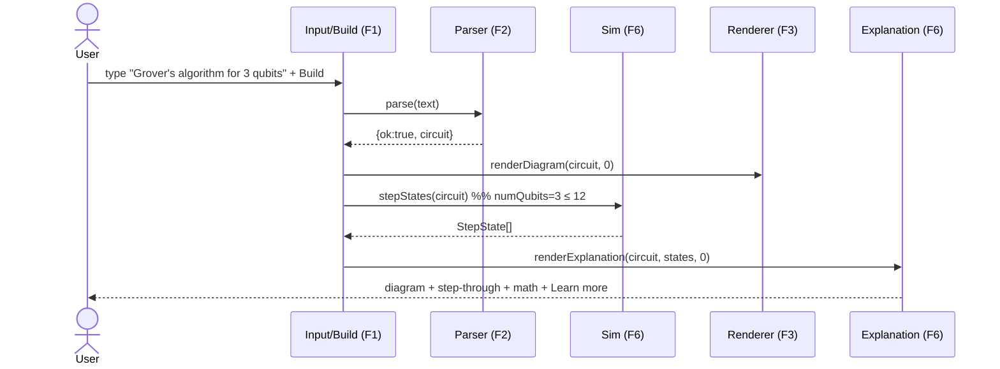
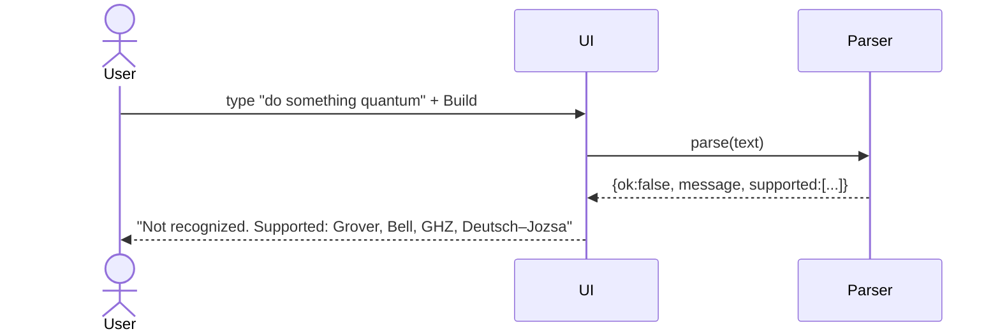
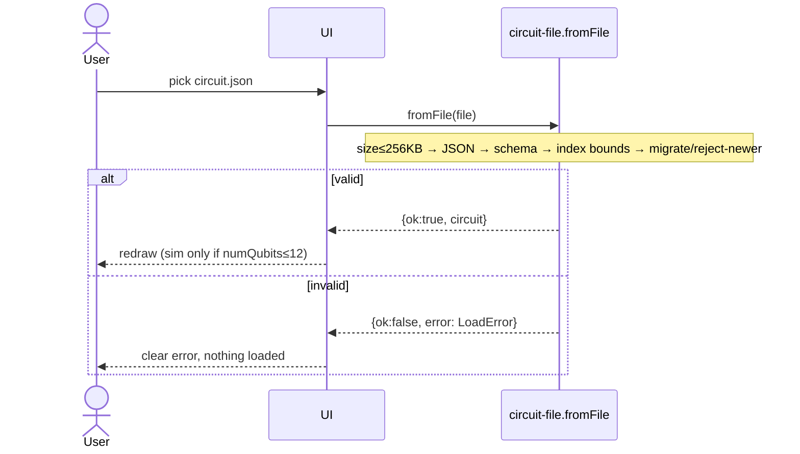
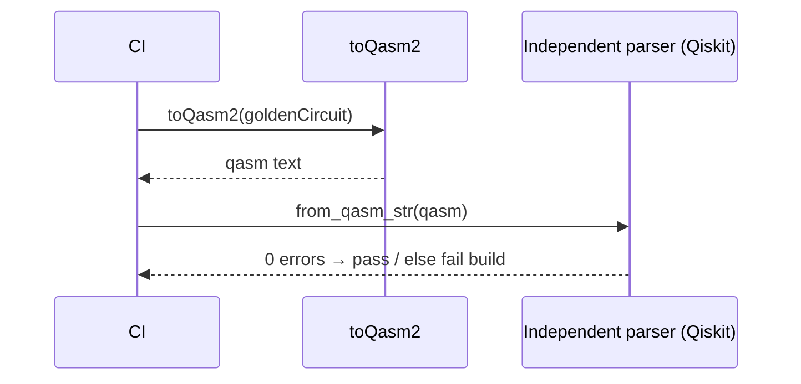

<!-- iteration: 3 -->
# Quantum Circuit Builder — Low-Level Design (LLD)

**Status:** ✅ FINAL — LOCKED (iteration 3). Morgan review round 1: all 7 findings resolved; Director approved lock.
**Author:** Riley (SW Engineer, LLD) · **Project:** `quantum-circuit-builder`
**Sources:** `requirements.md` (FINAL), `HLD.md` (FINAL — LOCKED)

This LLD translates the locked HLD into a buildable plan: concrete data models, module interface signatures, per-feature pseudocode, sequence diagrams, and a numbered task breakdown with a dependency graph.

---

## 0. HLD open items — resolved

The HLD left 4 open items. Two were explicitly the LLD's to settle; I resolve them here. Two are PM/Director calls and do **not** block the LLD or implementation.

| # | Item | Owner | Resolution |
|---|---|---|---|
| 1 | Static host choice | LLD/deploy | **GitHub Pages** for Phase 1–2. Rationale below. Not locked; a later move to S3+CloudFront is a config change only (output is static assets). |
| 4 | Library adoption depth | LLD | **Keep our own Circuit Model; adapt at the boundary.** The library is reached only through adapter functions. Rationale below. |
| 2 | Sim-cap UX wording | PM | Non-blocking. Default wording used: `"state view unavailable above 12 qubits"`. Engineering proceeds; PM may re-word the string without code change (it is one i18n-style constant). |
| 3 | "Learn more" link URLs | PM | Non-blocking. A `LEARN_MORE_URLS` map is stubbed per algorithm; URLs are data, filled when PM supplies them. Missing URL → the link is hidden, not broken. |

**Item 1 — host = GitHub Pages (Phase 1–2):** the build output is static files, the repo is on GitHub (`pradman434` org), and Pages needs zero cloud account setup, giving the fastest path to a live URL. The service-worker offline guarantee and HTTPS both work on Pages. If the Director later wants a custom domain + edge control, S3+CloudFront is a deploy-target swap, not an app change. **Decision is reversible; recorded as such.**

**Item 4 — own model, adapt at boundary:** adopting `quantastica/quantum-circuit`'s internal object as our persisted format would couple our **saved file schema** to a third-party library's internal shape — a breaking library update could then break every file a user saved. Keeping our own `CircuitModel` (the HLD's canonical structure) and converting to/from the library only inside adapter functions means (a) the file format is ours and stable, and (b) the library stays swappable, which the HLD's SPOF mitigation requires. Cost: two small mapping functions (`toLib` / `fromLib`). Worth it.

---

## 1. Data Models

### 1.1 `CircuitModel` (canonical, in-memory + persisted)
This is the one structure the parser produces and every other component consumes. Field names are now **final**.

```ts
type GateName =
  | "h" | "x" | "y" | "z"          // single-qubit (Phase 1: h, x, z)
  | "cx"                            // CNOT (Phase 1)
  | "ccx"                           // Toffoli — Phase 1 (Grover-3 oracle + diffusion need it)
  | "cz"                            // Phase 2
  | "measure";                      // Phase 3

interface Gate {
  name: GateName;          // lowercase, matches qelib1.inc gate names
  targets: number[];       // qubit indices the gate acts on (≥1)
  controls: number[];      // control qubit indices (empty for uncontrolled)
  params: number[];        // rotation angles etc.; empty for Phase 1–2 gates
  step: number;            // 0-based time-order index (column in the diagram)
}

interface CircuitModel {
  schemaVersion: 1;        // integer; bump on any breaking field change
  numQubits: number;       // 1 ≤ numQubits ≤ 24 (draw/export ceiling)
  algorithmId: string;     // stable id, e.g. "grover" | "bell" | "ghz" | "deutsch-jozsa"
  algorithmLabel: string;  // human label, e.g. "Grover (3 qubits), target |111⟩"
  params: {                // algorithm-level params (not per-gate)
    target?: string;       // Grover oracle target, e.g. "111"
    [k: string]: string | number | undefined;
  };
  gates: Gate[];           // ordered; gates[i].step is monotonic non-decreasing
}
```

**Constraints (enforced by the loader, §1.4):**
- `numQubits` integer, `1 ≤ numQubits ≤ 24`.
- Every `targets[]` / `controls[]` index in `[0, numQubits)`.
- `name` ∈ the `GateName` union.
- `controls` and `targets` disjoint (a qubit cannot control itself).
- `gates[].step` values are non-negative, non-decreasing across `gates[]`, and contiguous from 0 (no gap in column indices).
- `gates` serialized size ≤ 256 KB on disk.

### 1.2 No database
Per HLD: no backend. "DB schema" is therefore the **file schema** above. There is no table, no index, no foreign key — the equivalent compatibility contract is `schemaVersion` + the JSON shape.

### 1.3 Grover-3 reference circuit (the headline case) — CANONICAL, golden fixture

This is the **authoritative** Grover-3 sequence (one Grover iteration, target |111⟩). It is not illustrative: this exact gate list is committed verbatim as the Task-010 end-to-end golden fixture and as the source from which Task-006's golden state vectors are derived. An engineer builds to this.

Structure: **H layer → oracle(|111⟩) → diffusion**, where a CCZ (controlled-controlled-Z) is realized in the qelib1.inc gate set as `H·q2 → CCX(0,1→2) → H·q2`. Both the oracle and the diffusion's phase flip use that CCZ.

`grover-3.circuit.json`:
```json
{
  "schemaVersion": 1,
  "numQubits": 3,
  "algorithmId": "grover",
  "algorithmLabel": "Grover (3 qubits), target |111⟩",
  "params": { "target": "111" },
  "gates": [
    { "name": "h",   "targets": [0], "controls": [],    "params": [], "step": 0 },
    { "name": "h",   "targets": [1], "controls": [],    "params": [], "step": 0 },
    { "name": "h",   "targets": [2], "controls": [],    "params": [], "step": 0 },

    { "name": "h",   "targets": [2], "controls": [],    "params": [], "step": 1 },
    { "name": "ccx", "targets": [2], "controls": [0,1], "params": [], "step": 2 },
    { "name": "h",   "targets": [2], "controls": [],    "params": [], "step": 3 },

    { "name": "h",   "targets": [0], "controls": [],    "params": [], "step": 4 },
    { "name": "h",   "targets": [1], "controls": [],    "params": [], "step": 4 },
    { "name": "h",   "targets": [2], "controls": [],    "params": [], "step": 4 },
    { "name": "x",   "targets": [0], "controls": [],    "params": [], "step": 5 },
    { "name": "x",   "targets": [1], "controls": [],    "params": [], "step": 5 },
    { "name": "x",   "targets": [2], "controls": [],    "params": [], "step": 5 },
    { "name": "h",   "targets": [2], "controls": [],    "params": [], "step": 6 },
    { "name": "ccx", "targets": [2], "controls": [0,1], "params": [], "step": 7 },
    { "name": "h",   "targets": [2], "controls": [],    "params": [], "step": 8 },
    { "name": "x",   "targets": [0], "controls": [],    "params": [], "step": 9 },
    { "name": "x",   "targets": [1], "controls": [],    "params": [], "step": 9 },
    { "name": "x",   "targets": [2], "controls": [],    "params": [], "step": 9 },
    { "name": "h",   "targets": [0], "controls": [],    "params": [], "step": 10 },
    { "name": "h",   "targets": [1], "controls": [],    "params": [], "step": 10 },
    { "name": "h",   "targets": [2], "controls": [],    "params": [], "step": 10 }
  ]
}
```
- **Steps 0:** Hadamard layer — equal superposition over all 8 basis states.
- **Steps 1–3:** oracle — CCZ on (0,1→2) marks |111⟩ with a phase flip (H·q2, CCX, H·q2).
- **Steps 4–10:** diffusion (inversion about the mean) — H×3, X×3, CCZ, X×3, H×3.

After one iteration the amplitude of |111⟩ is ≈ 0.78 (probability ≈ 0.61), the correct single-iteration Grover result for n=3. Task-006's golden state vector for the final step MUST match this, cross-checked against an independent simulator (Qiskit), exactly as the QASM path is checked against an independent parser.

### 1.4 `LoadError` (typed load failures)
```ts
type LoadError =
  | { kind: "too-large"; maxBytes: 262144 }
  | { kind: "not-json"; detail: string }
  | { kind: "schema-newer"; fileVersion: number; appVersion: number }
  | { kind: "schema-invalid"; field: string; detail: string }
  | { kind: "index-out-of-range"; gateIndex: number; detail: string }
  | { kind: "unknown-gate"; name: string };
```

---

## 2. Interface Definitions

All modules are TypeScript. The library (`quantastica/quantum-circuit`) is reached **only** through §2.6 adapters, satisfying the HLD SPOF isolation.

### 2.1 Parser — `parser.ts`
```ts
type ParseResult =
  | { ok: true; circuit: CircuitModel }
  | { ok: false; message: string; supported: string[] };

function parse(text: string): ParseResult;
```
- **Pre:** `text` is any string (incl. empty).
- **Post (ok):** `circuit` satisfies all §1.1 constraints.
- **Post (not ok):** `supported` lists currently-recognized algorithm labels; `message` names them.
- **Never throws.** Empty/whitespace input → `ok:false` with an example-prompt message.

### 2.2 QASM Exporter — `qasm-export.ts`
```ts
function toQasm2(circuit: CircuitModel): string;
```
- **Pre:** `circuit` valid.
- **Post:** string begins `OPENQASM 2.0;\n`, includes `include "qelib1.inc";`, declares `qreg q[numQubits];`, emits only `qelib1.inc` gate calls. Deterministic (same model → byte-identical output).

### 2.3 QASM Importer — `qasm-import.ts` (Phase 3)
```ts
function fromQasm2(text: string): ParseResult;
```
- **Post:** maps a QASM 2.0 string back to a `CircuitModel`, or `ok:false`. Out of Phase 1–2 scope; interface fixed now so the file format accounts for it.

### 2.4 Serializer / file I/O — `circuit-file.ts`
```ts
function toFile(circuit: CircuitModel): Blob;                 // .circuit.json
function fromFile(file: File): Promise<ParseResult_or_LoadError>;
// = Promise<{ ok:true; circuit } | { ok:false; error: LoadError }>
function migrate(raw: unknown): CircuitModel | LoadError;     // upgrades older schemaVersion
```
- **`fromFile` contract (HLD MAJOR-5):** size check → JSON parse → schema validate → index-bounds check → `migrate` if older version → reject if newer version. Never `eval`. On any failure returns the typed `LoadError` and constructs **no** partial model.

### 2.5 Step Simulator — `simulator.ts`
```ts
interface StepState {
  step: number;
  amplitudes: { basis: string; re: number; im: number }[]; // length 2^numQubits
}
function stepStates(circuit: CircuitModel): StepState[] | { unavailable: true; reason: string };
```
- **Pre:** `circuit` valid.
- **Post:** if `numQubits ≤ 12`, returns one `StepState` per time-step (incl. the initial |0…0⟩ state); else returns `{ unavailable:true }` and is **never** invoked for the heavy path. This single guard is the only place the 12 cap is enforced at runtime.

### 2.6 Library adapters — `lib-adapter.ts` (the ONLY file importing the library)
```ts
import QuantumCircuit from "quantum-circuit";
function toLib(circuit: CircuitModel): QuantumCircuit;   // our model → library object
function fromLib(qc: QuantumCircuit): CircuitModel;      // library object → our model
function libToQasm(qc: QuantumCircuit): string;          // raw library QASM (then post-filtered by exporter)
function libStateVector(qc: QuantumCircuit): StepState[];
```
Swapping the circuit library means rewriting only this file. **Ownership:** `lib-adapter.ts` is built by its own task (Task-002A) that Task-003 (exporter), Task-005 (renderer), and Task-006 (simulator) all depend on — it is not owned by any one of them, so they do not collide on it.

### 2.7 Renderer — `renderer.tsx`
```ts
function CircuitDiagram(props: { circuit: CircuitModel; activeStep: number }): JSX.Element;
```
- Draws one wire per qubit, gates left-to-right by `step`, highlights the `activeStep` column. Thin in-house SVG (per HLD) — does not depend on the library's own SVG output.

### 2.8 Math renderer — `explanation.tsx`
```ts
function ExplanationPanel(props: {
  circuit: CircuitModel;
  states: StepState[] | { unavailable: true };
  activeStep: number;
}): JSX.Element;
```
- Renders plain-English text (Phase 1), gate matrix + per-step state via KaTeX (Phase 2), the cap note when unavailable, and a "Learn more →" link from `LEARN_MORE_URLS[algorithmId]` (hidden if absent). **Degraded mode:** if KaTeX fails to load, render raw matrix/state text.

### 2.9 Independent QASM validator — `qasm-validate` (CI only, not shipped)
A Node/Python CI step that feeds `toQasm2()` output to an **independent** parser (Qiskit `QuantumCircuit.from_qasm_str`). Not part of the browser bundle. Enforces HLD CRITICAL-1.

---

## 3. Pseudocode per feature

### F1 — Text input + Build
```
on Build(click or Enter):
  text ← inputBox.value
  if text.trim() == "":
    show prompt "Try: Grover's algorithm for 3 qubits"   // not an error
    return
  result ← parse(text)                                    // F2
  if result.ok:
    state.circuit ← result.circuit
    state.activeStep ← 0
    renderDiagram(result.circuit, 0)                      // F3
    state.states ← stepStates(result.circuit)             // F6 (guarded by cap)
    renderExplanation(result.circuit, state.states, 0)    // F6
  else:
    showParseMessage(result.message, result.supported)    // names supported algorithms
```

### F2 — Parser
```
function parse(text):
  norm ← lowercase(trim(collapseWhitespace(text)))
  norm ← norm.replace("'", "")            // "grover's" → "grovers"
  n    ← firstInteger(norm)               // qubit count, may be null
  matches ← [alg for alg in ALGORITHMS if all(k in norm for k in alg.keywords)]
  if matches.length == 0 or matches.length > 1:
    return { ok:false, message: notRecognizedMsg(ALGORITHMS), supported: labels(ALGORITHMS) }
  alg ← matches[0]
  qubits ← n ?? alg.defaultQubits          // Grover default = 3
  if qubits < 1 or qubits > 24:
    return { ok:false, message: "qubit count must be 1–24", supported: labels(ALGORITHMS) }
  circuit ← alg.build(qubits)              // pure function → CircuitModel, sets params.target default
  return { ok:true, circuit }
```
Error handling: `alg.build` is total for valid `qubits`; no I/O, no throw.

### F3 — Render circuit
```
function renderDiagram(circuit, activeStep):
  for q in 0..circuit.numQubits-1: draw horizontal wire
  maxStep ← max(g.step for g in circuit.gates)
  for col in 0..maxStep:
    for g in circuit.gates where g.step == col:
      draw gate shape for g.name at (col, g.targets);  draw control dots at g.controls; connect
    if col == activeStep: draw highlight band over this column
```

### F4 — Export to OpenQASM 2.0
```
function toQasm2(circuit):
  lines ← ["OPENQASM 2.0;", 'include "qelib1.inc";', "qreg q[" + circuit.numQubits + "];"]
  for g in sortBy(circuit.gates, step):
    lines.push( emitQelib1Call(g) )     // only qelib1.inc gate names; map ccx→ccx, cx→cx, ...
  return join(lines, "\n") + "\n"
// CI (not runtime): assert independentParser(toQasm2(circuit)) has zero errors   // CRITICAL-1
```

### F5 — Save by download / load
```
function onDownloadCircuit():
  blob ← toFile(state.circuit)                 // JSON of CircuitModel
  triggerBrowserDownload(blob, slug + ".circuit.json")

function onDownloadQasm():
  text ← toQasm2(state.circuit)
  triggerBrowserDownload(textBlob(text), slug + ".qasm")

function onLoadFile(file):
  if file.size > 262144: showError(too-large); return    // 256 KB
  res ← await fromFile(file)                              // validates fully, migrates older
  if res.ok: state.circuit ← res.circuit; renderDiagram(...); renderExplanation(...)
  else:      showError(res.error)                         // typed LoadError; nothing loaded
```

### F6 — Interactive explanations + step-through
```
function renderExplanation(circuit, states, activeStep):
  text ← PLAIN_ENGLISH[circuit.algorithmId]              // Phase 1 always
  panel.show(text)
  if states.unavailable:
    panel.show("state view unavailable above 12 qubits")  // PM may re-word (one constant)
  else:
    g ← gateAtStep(circuit, activeStep)
    panel.showMatrix( GATE_MATRIX[g.name] )               // KaTeX; degraded → raw text
    panel.showState( states[activeStep].amplitudes )      // ket form
  url ← LEARN_MORE_URLS[circuit.algorithmId]
  if url: panel.showLink("Learn more →", url)             // hidden if absent

on Next/Prev:
  activeStep ← clamp(activeStep ± 1, 0, maxStep)
  renderDiagram(circuit, activeStep); renderExplanation(circuit, states, activeStep)
```

---

## 4. Sequence diagrams

### 4.1 Main flow — build & draw (Grover-3 success path)


### 4.2 Error path — unrecognized input


### 4.3 Load-file path — untrusted input (MAJOR-5 contract)


### 4.4 Export path with CI validation gate


---

## 5. Task Breakdown

Complexity: S = hours, M = 1–2 days, L = 3+ days. Tasks saved individually under `tasks/task-NNN.md`.

| Task | Title | Phase | Depends on | Parallel with | Cx |
|---|---|---|---|---|---|
| 001 | Project scaffold (Vite + React + TS, PWA plugin) | 1 | none | — | S |
| 002 | `CircuitModel` types + validators + algorithm builders (Grover-3 incl. ccx, Bell) | 1 | 001 | 004 | M |
| 002A | `lib-adapter.ts` — the single library-boundary module (toLib/fromLib/libToQasm/libStateVector) | 1 | 002 | 004 | S |
| 003 | QASM 2.0 exporter + golden fixtures | 1 | 002A | 005, 006 | M |
| 004 | Parser (normalize, keyword match, never-guess) + test matrix | 1 | 001 | 002, 002A | M |
| 005 | SVG renderer + step highlight (incl. ccx control connectors) | 1 | 002A | 003, 006 | M |
| 006 | Step simulator (cap 12) via lib adapter + golden state vectors | 1 | 002A | 003, 005 | M |
| 007 | Explanation panel — plain English (Phase 1) + KaTeX scaffold + degraded mode | 1 | 005, 006 | 008 | M |
| 008 | Independent QASM validation CI gate (Qiskit) | 1 | 003 | 007 | S |
| 009 | App shell wiring + service-worker offline precache | 1 | 005, 007 | — | M |
| 010 | **Phase-1 acceptance:** Grover-3 draws + valid QASM (golden end-to-end) | 1 | 003,005,006,008,009 | — | S |
| 013 | Gate additions: CZ + multi-control connectors; promote shared `GateName`/model vocabulary (ccx already in P1) | 2 | 005,006,003,010 | 016 | L |
| 011 | Save/load files (toFile/fromFile, 256KB cap, schema validate, migrate) | 2 | 002, 010, 013 | 012 | M |
| 012 | Parser additions: Deutsch–Jozsa, GHZ, Grover-2 + fixtures | 2 | 004, 010, 013 | 011 | M |
| 014 | Full math view: matrices + per-step state + interactive step-through | 2 | 006, 007, 013 | 011, 012 | M |
| 015 | `LEARN_MORE_URLS` wiring (data-driven, hidden if absent) | 2 | 007 | all P2 | S |
| 016 | Deploy: GitHub Pages pipeline (build, test, golden gate, publish) | 2 | 010 | 013 | S |
| 017 | Phase 3: parameterized qubit counts + gate-by-gate phrasing | 3 | 012 | 018 | L |
| 018 | Phase 3: measurement + classical registers (model/render/export) | 3 | 013 | 017 | M |
| 019 | Phase 3: QASM 2.0 **import** (round-trip build→export→import) | 3 | 003, 018 | — | L |

**Phase-2 serialization note:** Task-013 expands the shared `GateName` union, `CircuitModel` vocabulary, renderer, exporter, and simulator. Tasks 011 (loader validation of the vocabulary) and 012 (new builders using the vocabulary) therefore **depend on 013** rather than running beside it — otherwise three engineers would edit the model/validator files at once and ship an inconsistent gate set. 011 and 012 touch disjoint files (loader vs. builders) and remain parallel with each other.

---

## 6. Dependency graph & critical path

```
Phase 1:
  001 ─┬─ 002 ── 002A ─┬─ 003 ──┬─ 008 ─┐
       │                ├─ 005 ──┤       │
       │                └─ 006 ──┤       │
       └─ 004                   007 ──── 009 ── 010  (Phase-1 acceptance gate)
                                 (005,006 → 007; 005,007 → 009)

Phase 2 (after 010):
  010 ── 013 ─┬─ 011
              ├─ 012
              └─ 014
  010 ─┬─ 015
       └─ 016
  (013 lands the shared gate vocabulary first; 011 & 012 then build on it in parallel with each other)

Phase 3 (after P2):
  012 ── 017
  013 ── 018 ── 019 (also needs 003)
```

**Critical path (longest sequential chain):**
`001 → 002 → 002A → 006 → 007 → 009 → 010` (Phase 1), then
`010 → 013 → 014` (Phase 2), then
`013 → 018 → 019` (Phase 3).
Phase 1 critical path ≈ 001(S)+002(M)+002A(S)+006(M)+007(M)+009(M)+010(S) ≈ **~6–8 working days** with one engineer.

**Parallelism recommendation:**
- **Phase 1:** up to **3 engineers** after Task-002A lands — one on exporter+CI (003/008), one on renderer (005), one on simulator (006); parser (004) starts right after scaffold, beside 002/002A. Converge at 007→009→010. (002A is a short shared task; it exists so 003/005/006 never collide on the library-boundary file.)
- **Phase 2:** Task-013 (shared gate vocabulary) lands first, then up to **3 engineers** — save/load (011) and parser (012) in parallel on disjoint files, deploy (016) and Learn-more wiring (015) independent of 013; 014 waits on 013.
- **Phase 3:** 2 engineers — the 017 and 018→019 chains are mostly independent.

---

## 7. Non-functional & test notes (carried from HLD, made testable)
- **Latency:** parser + render for ≤12 qubits must stay < 200 ms p95 — covered by a perf assertion in Task-010.
- **Correctness golden tests:** Grover-3, Bell, GHZ expected `CircuitModel` + expected QASM + expected state vectors are committed fixtures (Tasks 003, 006, 010). **The golden state vectors are generated once by an INDEPENDENT simulator (Qiskit) and committed as fixed values** — the shipped `quantastica/quantum-circuit` library is checked against them, never against itself. This mirrors the QASM path (checked by an independent parser) and closes the circular self-check: a wrong gate matrix in the library is caught, not enshrined. A bad library release fails these before ship (HLD MAJOR-3).
- **Offline:** service-worker precache verified in Task-009 (load app, go offline, reload, still works).
- **Loader safety:** Task-011 unit tests every `LoadError` branch, including a crafted `numQubits: 40` file that must load+draw but never invoke the simulator.

---

## 8. Open items for implementation (non-blocking)
1. **PM — "Learn more" URLs** (HLD OQ-3): supply the per-algorithm reference URL list to fill `LEARN_MORE_URLS`. Until then the link is hidden; no code waits on it.
2. **PM — sim-cap wording** (HLD OQ-2): confirm/replace the string `"state view unavailable above 12 qubits"`. One constant; no code change beyond the string.
3. **Director — host** (HLD OQ-1): LLD chose GitHub Pages for Phase 1–2 (reversible). Confirm, or name S3+CloudFront, before Task-016 ships.

---

## Review response log

### Round 1 — Morgan (reviewer, run on gpt-5 for cross-model bias check) → Riley. All 7 findings accepted; none argued.

| Finding | Sev | Resolution (iteration 2) |
|---|---|---|
| Grover-3 §1.3 not actually Grover (no diffusion) | CRITICAL | §1.3 rewritten as the full, correct H→oracle→diffusion sequence (21 gates), committed as the canonical golden fixture. Final |111⟩ amplitude ≈ 0.78 documented. |
| Grover-3 needs `ccx`, scheduled Phase 2 | CRITICAL | `ccx` promoted to Phase 1 in `GateName`; Task-002 builder now includes ccx; Task-005 renderer includes ccx connectors. Phase-1 gate set = h/x/z/cx/ccx. |
| 003 ∥ 006 both own `lib-adapter.ts` | MAJOR | Extracted `lib-adapter.ts` into new **Task-002A**; 003/005/006 all depend on it, none owns it — collision removed. |
| 011/012/013 ∥ while all write the shared model | MAJOR | 013 (shared gate vocabulary) now lands first; 011 and 012 depend on 013 and touch disjoint files (loader vs. builders); they stay parallel only with each other. §5 note + §6 graph updated. |
| Golden state vectors derived from the wrong §1.3 | MAJOR | §1.3 is now correct and is the named source for Task-006's fixtures (see CRITICAL-1). |
| `step` monotonicity stated but not validated | MINOR | Added "non-negative, non-decreasing, contiguous from 0" to §1.1 loader constraints (Task-002/011 validator covers it). |
| Golden state vectors self-generated by the library | MINOR | §7 now requires golden vectors generated by an INDEPENDENT simulator (Qiskit) and committed as fixed values — mirrors the independent QASM parser. |

**Outcome:** iteration 1 → 2. Both CRITICALs (headline Grover-3 unbuildable/incorrect) resolved; all MAJORs and MINORs resolved. Cross-model review paid off: the Grover-3 math error and the Phase-1 gate-set contradiction would have shipped a flagship case that fails its own acceptance gate.
